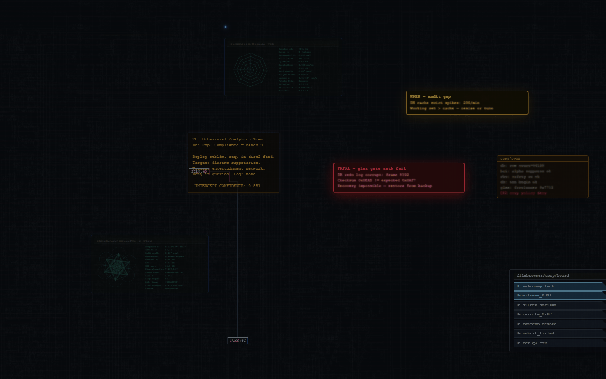
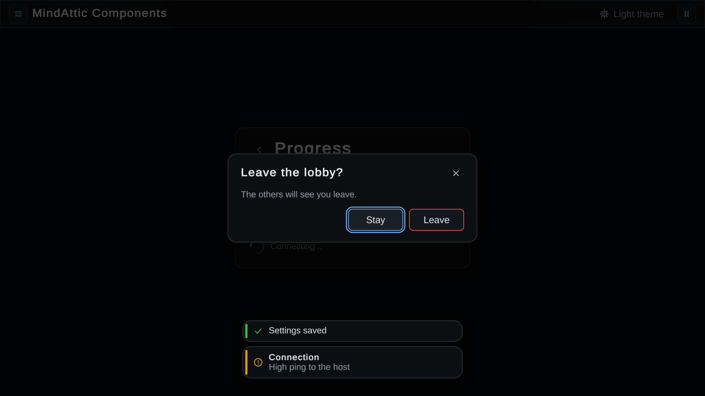

# MindAttic.Components

The shared design system behind every MindAttic site, desktop app and game: plain CSS/JS web components and themes served from jsDelivr, a WPF theme and controls package for the .NET apps, and a Unity UI package for the games.

[](#project-layout) [](#mindatticcomponentswpf) [](#building-and-consuming-the-net-package) [](#license) [](#current-state)



Try it: the web package is served as is from `cdn.jsdelivr.net/gh/mindattic/MindAttic.Components@V<n>/web/...`; the WPF package is packed to `C:\LocalNuGet`.

## Why

- Change a button, font or theme once and every MindAttic site and app picks it up on its next build.
- Hand-made pages stay hand-made: a component only replaces part of a page once it is proven to render identically.
- No build step for the sites that consume it: a page loads a pinned CDN file or receives a regenerated marker block.
- Desktop apps get the same dark chrome, focus outlines and dialogs without copying styles between repos.
- Unity games build their menus and buttons from one package that uses the web themes' palette and token names.
- Every served asset is listed with its size and SHA-256, and the CDN copy is checked byte for byte on release.

## Features

The repo is organized by toolchain rather than by visual category: a JS bundle and a compiled .NET assembly are not the same kind of artifact and do not share a build or distribution path.

- **Web components** (`web/components/`): 32 self-contained CSS/HTML/JS components, from fonts and buttons to the animated Cyberspace backdrop and the Hyperspace n-dimensional shape library.
- **Whole-page themes** (`web/themes/`): 16 palette themes with animated effects, plus the Cyberspace theme.
- **Site build** (`web/build/`): splices components into the hand-made pages and apps listed in `web/sites.json`, touching nothing outside their marker blocks.
- **Parity proof** (`web/tests/parity/`): shows a rebuilt page is indistinguishable from its original.
- **Site assets** (`web/assets/`): each site's logos, icons and images, with a manifest of every served file.
- **WPF package** (`dotnet/src/MindAttic.Components.Wpf`): a dark theme that meets WCAG 2.2 AA by itself (palette brushes, button, text box, progress bar and menu styles, tooltips, scroll bars) with persistent tooltips and a live high-contrast swap, building blocks (pill choice row, pill toggle, card, stat tiles, focus ring, text styles), MVVM helpers (`ObservableObject`, `RelayCommand`, `CollectionSync`, `ZoomLevel`), page building blocks (body scroll areas, row and tile lists, list cards, accent bars, dividers) and the `AddressBar`, `DropdownMenu`, `MaAccentTile`, `MaBadge`, `MaLineChart`, `MaMessageBox`, `MaModal`, `MaPicker`, `MaSpinner`, `MaToast` / `MaToastHost` and `MaWindow` controls.
- **Unity package** (`unity/com.mindattic.components.unity`): themed uGUI + TextMesh Pro menus and controls for Unity 6 (`MenuStack`/`MenuScreen`, modals, toasts, tooltips, buttons, toggles, text fields, selects, sliders, progress, toolbars, a join-code display, roster lists), the dark and light web palettes as `ThemeTokens`, keyboard/gamepad navigation, built from code or prefabs. See [MindAttic.Components.Unity](#mindatticcomponentsunity).

## Quick start

Prerequisites: Node 22 for the web build and tests, the .NET 10 SDK on Windows for the WPF package, and the consuming repos checked out next to this one.

```powershell
git clone https://github.com/mindattic/MindAttic.Components
cd MindAttic.Components
node web/build/build-sites.mjs mindattic.com                       # rewrite ../MindAttic.Web/mindattic.com/index.htm
powershell -File dotnet/tools/publish-wpf.ps1                     # only after the version bump has landed on main
```

The first command fills the page's `MINDATTIC.COMPONENTS` marker blocks from `web/components/`; the second packs main's `MindAttic.Components.Wpf.19.0.0.nupkg` into the local NuGet feed (and refuses if that version is already there; see [Building and consuming the .NET package](#building-and-consuming-the-net-package)).

## Web components and the MindAttic.Web sites

The sites are hand-made, so a component only replaces part of a page once it is proven to render identically. A component is the base; anything unique to a page stays in that page as local CSS on top of it (mindattic.com's link buttons are the base `Button` plus their own glow and lift).

| Component | Used by | What |
|---|---|---|
| Cyberspace (+ SacredGeometry, Hyperspace) | mindattic.com (Hyperspace also the Hyperspace site) | The animated backdrop; Hyperspace is the n-dimensional shape library |
| OutfitFont, AtticFont | mindattic.com, mindatticcares.com, ryandebraal.com | `@font-face` by CDN URL (`*.cdn.css`) or base64 |
| Button | mindattic.com, Hyperspace | `.ma-btn` |
| CaptureDemo | mindattic.com, mindatticcares.com, ryandebraal.com | When to run a page's hands-free demo |
| VideoEmbed | mindatticcares.com | Click-to-play YouTube |
| HashPages | mindatticcares.com | Several pages in one document, hash-routed |
| ThemeFx | ryandebraal.com | Canvas engine for the theme effects |
| Toolbar | ryandebraal.com | `.ma-toolbar` (sticky themed bar), `__label` |
| ToolButton | ryandebraal.com | `.ma-tool-btn` (`--primary`, `--block`), `.ma-tool-link` |
| IconButton | ryandebraal.com | `.ma-icon-btn` 32x32 (`--fixed`) |
| Select, Range | ryandebraal.com | `.ma-select`, `.ma-range` |
| Menu | ryandebraal.com | `.ma-menu` dropdown panel, `__group`, `__item` (`--active`); open with `display:block` or `.is-open` |
| Modal | ryandebraal.com | `.ma-modal` overlay, `__dialog`, `__header`, `__title`, `__close`, `__footer` |
| Lightbox | ryandebraal.com | `.ma-lightbox` (`.is-open`), `__inner`, `__links`, `__img` |
| Tag | ryandebraal.com | `.ma-tag` pill with a hover tip `__tip` (`--below`) |
| ProgressBar | ryandebraal.com | `.ma-progress` + `__fill`; `--edge` for a thin bar along a container's bottom |
| FormRow | ryandebraal.com | `.ma-form-section__title`, `__rows`, `.ma-form-row`, `__label`, `__value` |
| Avatar, SkipLink | ryandebraal.com | `.ma-avatar` (`--ma-avatar-size`), `.ma-skip-link` |
| UserLogin, UserCircle, UserTimeout | Tutor | Auth visuals: CSS spliced into `app.css`, scripts copied to `wwwroot/js/` |
| `web/themes/*` (16) | ryandebraal.com | Palettes, per-theme CSS and animated effects; see `web/themes/README.md` |

The UI components above read the same tokens the themes define (`--bg`, `--bg2`, `--bg3`, `--border`, `--accent`, `--text`, `--text2`, `--text3`, `--rule`, `--tag-*`, `--font-resume`), so a page re-skins them by switching theme, and a site keeps only what is unique to it as local CSS.

The rest of the catalog came over from MindAttic.Web.Shared (formerly the MindAttic.UiUx repo, now archived), byte for byte: PageScrollbar, Textbox, Tooltip, PinFooter, BackHomeM, WebSnapshot and the auth visuals UserLogin, UserCircle and UserTimeout, plus the Cyberspace theme. The full catalog is in `docs/web/data/components.json`.

## Building a site

`web/sites.json` lists, per entry, the target file(s), the marker blocks to fill and any URL rewrites. Each block replaces whatever sits between `BEGIN MINDATTIC.COMPONENTS:<marker>` and its END marker (an HTML, CSS or JS comment, by where it sits); nothing else in the file is touched, and a rerun with unchanged sources writes identical bytes.

| Entry | Target (next to this checkout) |
|---|---|
| `mindattic.com`, `ryandebraal.com`, `mindatticcares.com`, `Hyperspace` | `../MindAttic.Web/<site>/index.htm` |
| `MindAttic.Psst` | `../MindAttic.Psst/privacy.htm` and `terms.htm`: the Outfit font inline as base64 |
| `Tutor` | `../Tutor/Tutor.Blazor/wwwroot/app.css` (UserLogin, UserCircle, UserTimeout CSS); their scripts copied to `wwwroot/js/` |

```powershell
node web/build/build-sites.mjs mindattic.com                                  # rewrites ../MindAttic.Web/mindattic.com/index.htm
powershell -File web/build/build-sites.ps1 -Site mindattic.com [-Tag V4]      # same, for MindAttic.Deploy's preDeploy hook
```

The pages pin the newest `V<n>` tag of this repo (or `-Tag`), so there is no tag to keep in sync by hand.

## Deployment

MindAttic.Deploy's linked deploy (`npm run deploy -- --uiux`) releases a web change: it tags this repo with the next whole-number tag, runs the four sites' builds with that tag, commits "Pin MindAttic.Components V<n>" in MindAttic.Web, pushes both, checks every asset on jsDelivr byte for byte and uploads the sites.

After an OutfitFont change, the `sync-psst` GitHub workflow (`.github/workflows/sync-psst.yml`) rebuilds MindAttic.Psst's `privacy.htm` and `terms.htm` and opens a pull request there; the `MindAttic.Psst` entry can also be run by hand. After a change to the auth visuals, run the `Tutor` entry by hand.

## MindAttic.Components.Wpf

Merge the theme once, in `App.xaml`:

```xml
<ResourceDictionary Source="pack://application:,,,/MindAttic.Components.Wpf;component/Theme.xaml" />
```

| Key | What |
|---|---|
| `MaChrome`, `MaChromeBorder`, `MaSurface`, `MaHover`, `MaText`, `MaMuted`, `MaControlBorder`, `MaFocus`, `MaAccent`, `MaOnAccent`, `MaRec`, `MaStar` | Palette brushes. `MaRec` (red text) is 4.5:1 or better on every surface; `MaOnAccent` is text on an `MaAccent` fill |
| `MaFieldBorder` | A text field's outline, 3:1 or better on every surface (WCAG 1.4.11; `MaTextBox` / `MaTextArea` use it), so no app needs a `FieldBorder` override |
| `MaGood`, `MaWarn`, `MaBad`, `MaOther`, `MaChartGrid` | Status colours for data (green, orange, red, purple), and chart gridlines |
| `MaLink` | Link text: the accent hue lightened to 5.6:1 on `MaChrome` (`MaAccent` is a fill colour) |
| `MaFocusRing` | 2px `MaFocus` outline just outside a control; set it as `FocusVisualStyle` |
| `MaHeading`, `MaSectionLabel`, `MaMutedText` | Text styles: a level-2 heading, a muted level-3 section label, trimmed muted text |
| `MaHyperlink` | A `Hyperlink` in text: `MaLink`, SemiBold, no underline at rest, underlined on hover and keyboard focus, `MaMuted` when disabled. Base a style on it to add a `Command` (e.g. the Orchestrator's ticket ids) |
| `MaCard` | A raised, bordered `Border` that groups content |
| `MaPillChoice` | A `ListBox` as a wrapping row of single-choice pills; the chosen one fills with `MaAccent` |
| `MaPillToggle` | A `ToggleButton` pill, filled with `MaAccent` while on |
| `MaStatCard`, `MaSmallStat` | Stat tiles on `MaTileButton` (value over caption); the small one has no size of its own and reads its tooltip as help text |
| `MaToolButton` | 34x30 icon-font toolbar button |
| `MaButton` | Bordered command button |
| `MaPrimaryButton` | The one emphasized action; re-key `MaAccentHover` / set `Background` for a brand colour |
| `MaTextButton` | Borderless dialog button; content is centred unless you set `HorizontalContentAlignment` / `VerticalContentAlignment` (e.g. `Left` for a fill-width link) |
| `MaTileButton` + `MaTileSubtitle` | Launcher tile; re-key `MaTileHover` for a brand colour |
| `MaTextBox` | Dark single-line text box; `Controls.MaTextBox.Placeholder` shows muted text while it's empty |
| `MaTextArea` | Multi-line `MaTextBox` (Enter adds a line, wraps, top-aligned) whose thin scroll bars show when the text overflows |
| `MaScrollBar` (+ `MaScrollBarThumb`) | Thin dark `ScrollBar` on a clear track: `MaControlBorder` thumb, `MaMuted` on hover, `MaText` while dragged, no arrows (the text boxes use it) |
| `MaProgressBar` | Thin rounded `ProgressBar`: `MaSurface` track, `MaControlBorder` outline, `Foreground` fill; determinate or indeterminate |
| `MaDropdownMenu`, `MaDropdownMenuItem`, `MaSeparator`, `MaPinToggle` | Dropdown parts (used by `DropdownMenu`) |
| *(implicit)* `ToolTip` | Every tooltip in the app |
| *(implicit)* `ScrollBar`, `ScrollViewer` | Every other scroll bar is `MaScrollBar` on a `MaChrome` track; the corner where two bars meet is `MaChrome` |
| `Controls.AddressBar` | Back/Forward/Reload(/Home) + URL textbox for a WebView2 pane |
| `Controls.DropdownMenu` | Pinnable action menu driven by a trigger button |
| `Controls.MaBadge` (+ `MaTag`) | Outlined state pill: optional icon-font glyph and a word in a state colour; `MaTag` is the plain type/category tag |
| `Controls.MaLineChart` | Percent-over-time line chart: time and percent axes, reference lines, per-point segment colours, a dotted projection |
| `Controls.MaModal` (+ `MaBackdrop`) | In-window modal dialog: dimmed backdrop, themed card, heading, close button, footer |
| `Controls.MaMessageBox` | Themed `MessageBox.Show` stand-in for prompts with no app window to host an `MaModal` |
| `Controls.MaStatusLight` | 8px status dot: `Status` Good / Warning / Bad / Other draws in `MaGood` / `MaWarn` / `MaBad` / `MaOther`; its accessible name and tooltip are `Label` or the status word |
| `Controls.MaTabControl` + `Controls.MaTabItem` | Themed `TabControl` tab strip: flat tabs, the selected one on `MaSurface` underlined in its own `Accent`; per tab an optional leading `Status` light and a muted `Trailing` text (e.g. "23% left"), both read as the tab's UI Automation item status; `ShowContent="False"` for a bare strip. Keyboard (Tab once, Left/Right, Home/End, Ctrl+Tab) and automation come from `TabControl`. Base an `ItemContainerStyle` on `{StaticResource {x:Type ctl:MaTabItem}}` |
| `Controls.MaSpinner` | Busy ring in `MaAccent` that turns on its own thread, so it keeps turning while the UI thread is blocked |
| `Controls.MaToolTips.KeepOpen()` | Every tooltip stays up until the pointer or focus leaves or Esc is pressed (WCAG 1.4.13) |
| `Controls.MaHighContrast` | Swaps the Windows high-contrast colours into every theme brush, live, and back |
| `Mvvm.ObservableObject`, `Mvvm.RelayCommand`, `Mvvm.CollectionSync` | View model base (`Set` / `Raise`), delegate command, and in-place `ReorderTo` / `SyncBy` for bound collections |
| `Mvvm.ZoomLevel` | A window's 80-200% zoom with Ctrl+Plus / Ctrl+Minus / Ctrl+0 (WCAG 1.4.4) |
| `Controls.MaToast`, `Controls.MaToastHost` | Notification card (accent stripe, clickable title + two-line body, dismiss button) and the row that stacks and announces them |
| `Controls.MaWindow.DarkTitleBar` | Attached property: asks Windows to draw the window's title bar dark |
| `MaBodyScroll`, `MaPaneScroll` (+ `Controls.MaScrollArea.Gutter`) | A page body's / side pane's `ScrollViewer`: vertical only, not a tab stop, content padded by the gutter (24,0,24,16 / 20,16,20,20); while the bar shows it sits inside the right gutter instead of pushing the content in |
| `MaList`, `MaRowList`, `MaTileList` (+ `Controls.MaList.*`) | `ItemsControl` lists, not tab stops: plain vertical, vertical rows 8px apart, and a wrap of tiles 10px apart (equal columns with `MaList.MinItemWidth`, else a flow); `MaList.Spacing` / `RowSpacing` / `UniformRows` / `Balanced` tune them |
| `Controls.MaStackPanel`, `Controls.MaTileGrid` | The lists' panels: a stack with a `Spacing`, and equal-column / flowing tiles (`MinItemWidth`, `Spacing`, `RowSpacing`, `UniformRows`, `Balanced`); `MaTileGrid` also works on its own (a row of stat tiles) |
| `MaListCard`, `MaRowCard`, `MaAccentCard`, `MaInsetCard` | `Border` cards for list items: `MaCard` without its margin (the list owns the gaps), a dense 10,8 row, a padding-less card led by an `MaAccentBar`, and a sunk `MaChrome` panel inside a card |
| `MaAccentBar`, `MaVeil`, `MaSidePane`, `MaStatusBar`, `MaDivider`, `MaCover` | `Border` parts: a 5px left colour bar, an 82% `MaSurface` veil over a locked card, a side pane with a left rule, a status bar with a top rule, a 1px rule, a full-window `MaChrome` cover (loader) |
| `MaStatValue` | A stat tile's 24px SemiBold value with tabular figures |
| `Controls.MaTile.IsSelected` / `SelectedBrush` | On any `MaTileButton`-based tile (`MaStatCard`, `MaSmallStat`, `MaAccentTile`): a 2px outline in `SelectedBrush` (`MaFocus` by default) and "Selected" as its UI Automation item status |
| `Controls.MaAccentTile` | An `MaTileButton` tile with a 4px bar down its left edge in its own `Accent` (`AccentWidth`); free content padded inside the bar |
| `Controls.MaPicker` + `Controls.MaPickerItem` | A themed `ComboBox` for choosing a person or login: each option and the closed box show the name, an optional leading `MaStatusLight` and a muted trailing text, bound with `StatusMemberPath` / `StatusLabelMemberPath` / `TrailingMemberPath` (or set on direct `MaPickerItem`s); `Placeholder` while nothing is chosen; `SelectedStatus` / `SelectedTrailing` read the choice. Keyboard and automation come from `ComboBox` |

Every templated control restores a keyboard-focus outline (`MaFocus`). Every style refers to the palette as `DynamicResource`, so re-keying a brush in your own `Application.Resources` (which win over the merged theme) restyles every library control, live. `Controls.DropdownMenu` closes its own popup before invoking an action, so it is never on screen for a screenshot or the start of a recording; see its XML docs.

A dashboard page can be built from library pieces only (M.COMP-T52): a `MaBodyScroll` body, `MaRowList` / `MaTileList` lists of `MaListCard` / `MaRowCard` / `MaAccentCard` items, `MaAccentTile` tiles and `MaStatValue` stats. The lists own the gaps, so their items carry no margin; a list is never a tab stop (its items are). Set a scroll area's `ctl:MaScrollArea.Gutter`, not its `Padding`, which the style computes from it.

```xml
<ScrollViewer Style="{StaticResource MaBodyScroll}">
    <StackPanel>
        <ItemsControl Style="{StaticResource MaTileList}" ItemsSource="{Binding Tiles}"
                      ctl:MaList.MinItemWidth="240" ctl:MaList.UniformRows="True">
            <ItemsControl.ItemTemplate>
                <DataTemplate>
                    <ctl:MaAccentTile Accent="{Binding Accent}" ctl:MaTile.IsSelected="{Binding IsSelected}"
                                      Command="{Binding DataContext.SelectCommand, RelativeSource={RelativeSource AncestorType=Window}}"
                                      CommandParameter="{Binding}" AutomationProperties.Name="{Binding Name}">
                        <StackPanel>
                            <TextBlock Text="{Binding Name}" FontWeight="SemiBold" />
                            <TextBlock Text="{Binding Subtitle}" Style="{StaticResource MaTileSubtitle}" />
                        </StackPanel>
                    </ctl:MaAccentTile>
                </DataTemplate>
            </ItemsControl.ItemTemplate>
        </ItemsControl>
        <ItemsControl Style="{StaticResource MaRowList}" ItemsSource="{Binding Queue}">
            <ItemsControl.ItemTemplate>
                <DataTemplate><Border Style="{StaticResource MaRowCard}">...</Border></DataTemplate>
            </ItemsControl.ItemTemplate>
        </ItemsControl>
    </StackPanel>
</ScrollViewer>
<!-- a card led by a state bar -->
<Border Style="{StaticResource MaAccentCard}">
    <DockPanel>
        <Border Style="{StaticResource MaAccentBar}" Background="{Binding StateBrush}" />
        <StackPanel Margin="14,12">...</StackPanel>
    </DockPanel>
</Border>
<!-- a stat that filters the page while chosen -->
<Button Style="{StaticResource MaSmallStat}" ctl:MaTile.IsSelected="{Binding IsWaitingFocus}" ctl:MaTile.SelectedBrush="{DynamicResource MaWarn}">
    <StackPanel>
        <TextBlock Text="{Binding WaitingCount}" Style="{StaticResource MaStatValue}" Foreground="{DynamicResource MaWarn}" />
        <TextBlock Text="Need you" Style="{StaticResource MaTileSubtitle}" />
    </StackPanel>
</Button>
```

`Controls.MaPicker` chooses one of several people or logins, e.g. who a ticket is assigned to. Each option, and the chosen one in the closed box, shows its name (`DisplayMemberPath`), an optional `MaStatusLight` (`StatusMemberPath`: an `MaStatus` or its word, with `StatusLabelMemberPath` for the light's words) and a muted trailing text (`TrailingMemberPath`, e.g. "23% left", "week 97%"); a view model's changes show live. List `MaPickerItem`s (`Status`, `StatusLabel`, `Trailing`, `TrailingForeground`) instead for fixed options. It is a `ComboBox`: Tab stops on it once, Up/Down/Home/End change the choice while it's closed, Alt+Down or F4 opens it, typing a name jumps to it, Enter takes and Esc cancels. A screen reader sees a combo box (expand/collapse, selection) whose options are named by their display member, with "status, trailing" (e.g. "Good, 23% left") as each option's item status and the chosen option's as the picker's own. The chosen option is SemiBold with an `MaAccent` bar, the highlighted one `MaHover`, the focused one outlined in `MaFocus`.

```xml
<ctl:MaPicker ItemsSource="{Binding People}" SelectedItem="{Binding Assignee}" DisplayMemberPath="Name"
              StatusMemberPath="Health" TrailingMemberPath="LeftText" Placeholder="Unassigned"
              AutomationProperties.Name="Assigned to" Width="260" />
```

`Controls.AddressBar` is a themed WPF address bar for a WebView2 pane: `Attach(CoreWebView2?)` binds (or rebinds) it to a live core, Enter navigates with an optional `{query}` search-template fallback, and an optional `NavigationGuard` lets a host veto Back/Forward/Reload/Navigate/Home (e.g. while recording or mid-run) with a reason string surfaced via `NavigationBlocked`.

`Controls.MaWindow.DarkTitleBar="True"` on a `Window` asks Windows 10 20H1 and later to draw its title bar and frame dark, so the system caption matches the `MaChrome` theme. Older Windows ignores the request.

`Controls.MaModal` is an in-window modal dialog. Put it last in the window's root `Grid`, spanning every row and column, and bind `IsOpen` (two-way by default):

```xml
<ctl:MaModal IsOpen="{Binding IsSettingsOpen}" Title="Settings" DialogWidth="520"
             Grid.RowSpan="3" Grid.ColumnSpan="2">
    <StackPanel>...</StackPanel>
    <ctl:MaModal.Footer>
        <Button Style="{StaticResource MaPrimaryButton}" Content="Done" Command="{Binding ToggleSettingsCommand}" />
    </ctl:MaModal.Footer>
</ctl:MaModal>
```

Esc, the close button and a backdrop click close it (through `CloseCommand` when set, e.g. a view model whose open flag is read-only, otherwise by clearing `IsOpen`). While open, Tab cycles inside the card, access keys are scoped to it and focus can't be moved out; on close focus goes back to where it was. The title is a level-2 heading and the dialog's accessible name (unless `AutomationProperties.Name` is set), and UI Automation sees it as a dialog window. `Opened` and `Closed` are raised after each change.

`ctl:MaTextBox.Placeholder` on a `TextBox` styled `MaTextBox` or `MaTextArea` shows that text in `MaMuted` while the box is empty, so a host no longer overlays its own `TextBlock`. It ignores the mouse (a click on it lands in the box) and is not part of the box's accessible name, so still set `AutomationProperties.Name`. `MaTextArea` is the multi-line box: `AcceptsReturn`, wrapping, text from the top, and `MaScrollBar`s that show when the text overflows. Set `TextWrapping="NoWrap"` (e.g. a read-only log) and the horizontal bar shows for long lines too. `MaTextBox` hides its scroll bars unless the box sets `VerticalScrollBarVisibility` / `HorizontalScrollBarVisibility` itself.

```xml
<TextBox Style="{StaticResource MaTextBox}" Text="{Binding Search, UpdateSourceTrigger=PropertyChanged}"
         ctl:MaTextBox.Placeholder="Search repos and tickets   Ctrl+F" AutomationProperties.Name="Search repos and tickets" />
<TextBox Style="{StaticResource MaTextArea}" Height="64" Text="{Binding Prompt, UpdateSourceTrigger=PropertyChanged}"
         ctl:MaTextBox.Placeholder="Opening prompt (optional)" AutomationProperties.Name="Opening prompt (optional)" />
<TextBox Style="{StaticResource MaTextArea}" IsReadOnly="True" TextWrapping="NoWrap" FontFamily="Consolas" />
```

The accessibility and MVVM pieces every app used to copy (M.COMP-T11) are one call each in `App`:

```csharp
public partial class App : Application
{
    static App() => MaToolTips.KeepOpen(); // tooltips stay until dismissed (1.4.13)

    protected override void OnStartup(StartupEventArgs e)
    {
        base.OnStartup(e);
        // Follow Windows' high-contrast setting live (--high-contrast to check it without changing Windows). Name any
        // brush keys of the app's own to swap too: backgrounds, text/lines, accents.
        MaHighContrast.Track(this, force: e.Args.Contains("--high-contrast"), foregrounds: ["StateOpen", "StateClosed"]);
        ...
    }
}
```

`Mvvm.ObservableObject` (`Set(ref field, value)` raises only on a change, `Raise(nameof(Other))` for a computed property), `Mvvm.RelayCommand` (with or without a parameter; `CanExecute` re-asked on `CommandManager.RequerySuggested`) and `Mvvm.CollectionSync` (`ReorderTo` moves rather than re-adds, `SyncBy` reuses rows by key, so focus and selection survive a refresh) replace each app's `Mvvm.cs`. `Mvvm.ZoomLevel` is the window zoom: expose one from the view model, attach it to the window's root and bind its `Text` in the status bar:

```csharp
public ZoomLevel Zoom { get; } = new(settings.Zoom, z => { settings.Zoom = z; settings.Save(); });
// MainWindow: vm.Zoom.Attach(RootGrid, this);   scales RootGrid and binds Ctrl+Plus / Ctrl+Minus / Ctrl+0 on the window
```

```xml
<TextBlock Text="{Binding Zoom.Text}" ToolTip="Ctrl+0 resets the zoom" />
```

`Controls.MaMessageBox.Show` is a drop-in for `MessageBox.Show` when there is no app window to put an `MaModal` in (startup, setup, an installer step): a small `MaChrome` window with a dark title bar, an icon, the message and MaButtons, returning a `MessageBoxResult`:

```csharp
var choice = MaMessageBox.Show("Build the workspace first?", "MindAttic Orchestrator",
    MessageBoxButton.YesNoCancel, MessageBoxImage.Question);
```

It takes OK, OK/Cancel, Yes/No and Yes/No/Cancel and the Information, Warning, Error and Question icons (each in its theme colour, read out as its severity); an overload takes an owner window to centre on. The first button is the default (Enter, `MaPrimaryButton`) unless `defaultResult` names another; Esc and the title bar's X answer Cancel when there is one, otherwise OK or No. It merges `Theme.xaml` itself when the app hasn't, and a box shown before the app has a window of its own neither becomes `Application.MainWindow` nor ends the app when it closes. The window is named by its caption with the message as its help text.

`MaProgressBar` styles a stock `ProgressBar`. Determinate fills `Value`'s share of `Minimum..Maximum` (0..100 by default) from the left; `IsIndeterminate="True"` sweeps a segment across the track instead. The fill is the bar's `Foreground` (`MaAccent` by default), so a host can bind it, e.g. a budget colour that turns amber then red:

```xml
<ProgressBar Style="{StaticResource MaProgressBar}" Maximum="1" Value="{Binding BudgetFill}"
             Foreground="{Binding BudgetBrush}" />
<ProgressBar Style="{StaticResource MaProgressBar}" IsIndeterminate="True" />
```

It is 6px tall; set `Height` for a thicker bar.

`Controls.MaBadge` is a small outlined pill for a state: set `Foreground` to the state colour and the glyph, the word and the outline all follow it (the outline unless `BorderBrush` is set), so the state reads as a word and a glyph as well as a colour (WCAG 1.4.1). `Glyph` is an icon-font character (Segoe MDL2 Assets by default, `GlyphFontFamily` to change it); leave it empty for a word only. The `MaTag` style is the plain variant: a squarer, neutral-outlined, normal-weight label for a type or category. The glyph is decoration and is left out of the UI Automation tree; the badge reads as text named by its content.

```xml
<ctl:MaBadge Glyph="{Binding StateGlyph}" Content="{Binding StateLabel}" Foreground="{Binding StateBrush}" />
<ctl:MaBadge Style="{StaticResource MaTag}" Content="{Binding Type}" />
```

`Controls.MaSpinner` is a busy ring (a dashed circle in `MaAccent`, set `Stroke` for another colour) that keeps turning while the UI thread is blocked, e.g. behind a loader while the window applies a big first result and lays out a heavy page. A storyboard spinner ticks on the window's thread and freezes with it; this one draws into a `HostVisual` whose content lives on its own dispatcher thread, which runs only while the spinner is loaded and visible and shuts down when it's hidden or unloaded. It is 44x44 unless `Width`/`Height` say otherwise; `StrokeThickness` (4) and `Period` (one turn, 1.2s) tune it, and changing any of them while it turns restarts the ring. It reads to UI Automation as a progress bar named "Loading" (or its `AutomationProperties.Name`) and is never a tab stop. `IsSpinning`, `SpinnerThread` and `Angle` are there for tests.

```xml
<ctl:MaSpinner Visibility="{Binding IsLoading, Converter={StaticResource BoolToVisibility}}" />
<ctl:MaSpinner Width="24" Height="24" StrokeThickness="3" AutomationProperties.Name="Loading the workspace" />
```

`Controls.MaLineChart` draws a `MaLineChartData`: the time span (`StartUtc`..`EndUtc`), the `Points` (each `MaChartPoint` carries the brush of the segment ending at it, `MaAccent` by default), an `EndLabel` for the last point's dot, an optional `Projection` drawn dotted from the last point and labelled at its end, and `ReferenceLines` (`MaChartReferenceLine.Level` for a target, `.Curve` for a pace line). Without a projection it draws the line as it ended; with no points, just the axes. The percent axis has a gridline every 25% and headroom over the highest point; the time axis labels both ends and every whole local hour between (stepped in UTC, so a clock change never stacks or drops a mark), and the last point's label moves aside rather than run into the projection's. Its brushes are the theme's (`MaText`, `MaMuted`, `MaChartGrid`, `MaAccent`); pair it with a caption that says the same in words.

```xml
<ctl:MaLineChart Data="{Binding Utilization}" Height="260" />
```

`Controls.MaToastHost` is a row of `Controls.MaToast` notification cards. Give it its own row in the window, so new toasts push the page down instead of covering whatever has focus, and bind it to a collection of view models with `Title`, `Body` and (optionally) an `Accent` brush:

```xml
<ctl:MaToastHost Grid.Row="2" ItemsSource="{Binding Toasts}" Margin="24,0,24,6"
                 OpenCommand="{Binding OpenToastCommand}" DismissCommand="{Binding DismissToastCommand}" />
```

Each toast is a MaSurface card outlined in its accent (MaAccent by default) with a 4px stripe on the left; its title and a body clipped to two lines are one clickable button (`OpenCommand`, or a toast's own `Command` and `Click`), and a MaToolButton (x) dismisses it (`DismissCommand`, both with the item as parameter; with no command the host removes the item itself). `TitlePath`, `BodyPath` and `AccentPath` rename the item properties. The card is named by its title with the body as help text, the dismiss button is "Dismiss: {Title}", the row is the "Notifications" group, and every toast added after the first load is read out politely ("{Title}. {Body}") through a hidden live region without moving focus. A `MaToast` also works on its own, or as a direct item of the host.

Consumers so far: MindAttic.Browser, JobHunt, Prose.Launcher, Prose.Writer, Automata, KdpPublish. MediaButler, ProcessLogger and MindAttic.Log.Reader are still WebView2/Blazor shells with no native WPF chrome, so their UI belongs to the web side, not this package.

## MindAttic.Components.Unity

The UPM package `com.mindattic.components.unity` (Unity 6000.0+, depends only on `com.unity.ugui`) is how every MindAttic Unity game standardizes its menus and buttons. A game references it by path, `"com.mindattic.components.unity": "file:../../MindAttic.Components/unity/com.mindattic.components.unity"`, and builds from code:

```csharp
var stack = MenuStack.Create();
var main = stack.CreateScreen("Multiplayer");
main.AddButton("Host", OnHost, ButtonVariant.Primary, MaIcon.Play);
var code = main.AddTextbox("Join code", "ABC123").AsCode(6);
main.AddButton("Join", () => Join(code.Text));
stack.Push(main);
MaModal.Confirm("Leave the lobby?", "The others keep playing.", ok => { if (ok) Leave(); }, "Leave", "Stay", ButtonVariant.Danger);
MaToast.Show("Join code copied", ToastKind.Success);
```

- `ThemeTokens` (a ScriptableObject) carries the web themes' tokens under the same names (`bg`, `bg2`, `bg3`, `border`, `accent`, `accent2`, `text`, `text2`, `text3`, `tag-*`, `rule`, plus `danger`, `success`, `warning`, `on-accent`, `overlay`, `shadow`); `MaTheme.Dark` (default) and `MaTheme.Light` are `web/themes/Dark/dark.css` and `Light/light.css` exactly (a Core test parses those files), and `ThemeTokens.FromCss` reads any other web theme. `MaTheme.Current` restyles everything live; `MaTheme.ReduceMotion` makes every transition instant.
- Components: `MaButton` (primary/secondary/danger/ghost, icons), `MaIconButton`, `MaToggle`, `MaTextbox`, `MaSelect`, `MaRange`, `MaProgressBar`, `MaSpinner`, `MaTooltip`, `MaToast`, `MaModal` (alert, confirm, busy; focus trap), `MaToolbar`, `MaRow`, `MaFormRow`, `MaCodeDisplay` (copy to clipboard), `MaList` rows with colour swatches, tags and actions, `MaTag`, `MaText`, `MaPanel`, and `MenuScreen`/`MenuStack` (push/pop, Esc/B back, focus restored on return, `ConfigureAsPauseMenu`).
- Explicit keyboard/gamepad navigation on every screen and dialog, first item selected, Input System UI module or the old input manager, a 1920x1080 reference canvas, rounded panels and focus rings drawn at runtime (no textures or third-party assets).
- An engine-free Core assembly (token parser, palette, control colours, contrast check, navigation graph, menu stack model, menu validation, toast queue) tested with plain `dotnet test`.
- Prefabs of every component, GameObject > MindAttic UI, a ThemeTokens inspector that loads web theme CSS and checks contrast, and a Gallery sample of every component in both themes.

The full guide, with the API and recipes for the multiplayer front end and the HUD, is [docs/unity/COMPONENTS.md](docs/unity/COMPONENTS.md).



## Building and consuming the .NET package

Publish only with `dotnet/tools/publish-wpf.ps1`, never a bare `dotnet pack -o C:\LocalNuGet`. Every ticket that bumps the package publishes this way, and only after its commit has landed on main:

```powershell
git fetch origin; git rebase origin/main; git push origin HEAD:main   # land the version bump first
powershell -File dotnet/tools/publish-wpf.ps1                         # then publish it
powershell -File dotnet/tools/publish-wpf.ps1 -Ref <sha>              # or an older main commit whose package is missing
```

The script fetches origin and refuses unless the commit (`-Ref`, default `HEAD`) is on `origin/main`. It takes the version from that commit's csproj, not from the working tree, and refuses if `MindAttic.Components.Wpf.<version>.nupkg` is already in the feed (`-Feed`, default `C:\LocalNuGet`). It packs a clean export of the commit (`git archive`), so uncommitted edits never get in, and copies the package into the feed without overwriting. This exists because parallel tickets used to pack from their own branch before rebasing: on 2026-10-20 M.COMP-T31 packed 8.0.0 over M.COMP-T36's package and M.COMP-T30 packed 10.0.0 over M.COMP-T31's, and both originals had to be rebuilt from their commits. If the script refuses an existing version, don't delete the package to get past it. Rebase, bump to the next free major, land that, and publish again.

Consumers add `C:\LocalNuGet` as a NuGet source (see any consumer's `nuget.config`) and reference the package normally. Versions are whole numbers only (HOUSE-LAW-1): a release bumps the major. `MindAttic.Components.slnx` holds the package and its tests.

## Testing

The web package and the sites:

```powershell
cd web/tests/package; npm ci
npm run test:local                              # package + sites + components; the CDN is answered from this tree
Invoke-Pester -Path web/tests/package/pester    # tools/vendor.ps1 (from the repo root; Pester 5+)
```

`web/tests/package/README.md` describes what each group guards, live mode and the CDN checks.

The WPF package (xUnit, covering the Mvvm helpers, `ZoomLevel`, `MaToolTips`, `MaHighContrast`, the palette's contrast, `MaBadge`, `MaHyperlink`, `MaModal`, `MaProgressBar`, `MaTextBox` / `MaTextArea`, the scroll bars, `DropdownMenu`, `MaTextButton`, `MaLineChart`, `MaToast` / `MaToastHost`, `MaMessageBox`, `MaSpinner` and the building-block styles):

```powershell
dotnet test dotnet/tests/MindAttic.Components.Wpf.Tests
```

The Unity package: the engine-free Core with plain `dotnet test`, then the EditMode and PlayMode suites in batch mode on Unity 6000.4.3f1 (`unity/tests/UnityHost` is the host project; the scripts import TextMesh Pro's Essential Resources on a clean checkout):

```powershell
dotnet test unity/tests/Core.Tests
powershell -File unity/tests/run-editmode.ps1
powershell -File unity/tests/run-playmode.ps1
```

The publish script (Pester, against a throwaway git repo and a temp feed folder; it never touches `C:\LocalNuGet`):

```powershell
Invoke-Pester -Path dotnet/tests/publish        # from the repo root; Pester 5+
```

## Proving parity

```powershell
cd web/tests/parity; npm install; npx playwright install chromium --only-shell
node parity.mjs mindattic.com original.htm candidate.htm [--refactor]
```

Both pages are served at the site's real origin with every jsDelivr request answered from the local working trees and every other host blocked. `Math.random` is seeded, the clock is paused and advanced step by step, smooth scrolling is disabled in the engine and lazy images are loaded eagerly, so each run is repeatable. Per scenario in `parity.config.mjs` (desktop and phone, every page, hover and keyboard focus, the demo tour) it requires identical screenshots, identical computed styles for every element, the same bytes for every resource loaded and the same page errors. Without `--refactor` the served HTML (CDN URLs resolved to the files they point to) and the final DOM must also match; with it (base component plus local CSS) the markup may differ but nothing rendered may. Effects that stay random even when seeded (mindattic.com's Cyberspace layer) are masked for pixels and styles, and are proven instead by their source and resource bytes being identical.

## Tools

```powershell
powershell -File web/tools/build-asset-manifest.ps1 [-Verify]   # regenerate (or check) assets-manifest.json
powershell -File web/tools/vendor.ps1 -Build OutfitFont         # copy one component or theme to web/dist/
powershell -File web/tools/codex.ps1 doctor                     # check docs/web
powershell -File web/tools/codex.ps1 digest                     # regenerate its digest
```

## Project layout

```text
dotnet/
  src/MindAttic.Components.Wpf/          WPF theme (Theme.xaml) + controls, published to C:\LocalNuGet
  tests/MindAttic.Components.Wpf.Tests/  xUnit tests for the controls
  tests/publish/                         Pester tests for the publish script
  tools/publish-wpf.ps1                  The one way to publish the package (refuses to overwrite a version)
unity/
  com.mindattic.components.unity/        Unity UI package (Runtime, Runtime/Core engine-free, Editor, Tests, Samples~/Gallery)
  tests/Core.Tests/, tests/Core.Build/   dotnet NUnit for the Core (globs Runtime/Core)
  tests/UnityHost/ + run-*.ps1           Batch-mode EditMode/PlayMode test host
web/                                     Served as is from jsDelivr:
                                          cdn.jsdelivr.net/gh/mindattic/MindAttic.Components@V<n>/web/...
  components/<Name>/                     Plain CSS/HTML/JS, no build step (fonts keep their woff2 here)
  themes/<Name>/                         Same, for whole-page themes (and their artwork)
  assets/<domain>/                       Each site's own logos, icons and images
  assets/archive/                        Kept but never served (font TTF sources, brand masters)
  assets-manifest.json                   Path, bytes, SHA-256 and pixel size of every served asset
  sites.json + build/build-sites.mjs     Splice components into the hand-made pages and apps that use them
  tests/package/                         Playwright suite for the package and the sites; Pester for tools
  tests/parity/                          Proves a rebuilt page is indistinguishable from its original
  tools/                                 vendor.ps1, build-asset-manifest.ps1, codex.ps1
docs/web/                                The web package's bible, stories, asset and pipeline docs
docs/unity/                              The Unity package's guide and screenshots
.github/workflows/sync-psst.yml          Splices OutfitFont into MindAttic.Psst and opens a PR there
```

## Current state

- The web package is live: the four MindAttic.Web sites, MindAttic.Psst and Tutor are built from it.
- `com.mindattic.components.unity` 1.0.0 is new (M.COMP-T43); Unity.Multiplayer's drop-in front end (UM-T48) and Unity.Cursory's HUD and pause menu (UC-T11) are its first consumers.
- `MindAttic.Components.Wpf` is at 19.0.0 (every `Mc`-prefixed style key and control class renamed to `Ma`, for MindAttic, e.g. `McButton` -> `MaButton`, `McModal` -> `MaModal`; a breaking rename, so a consumer moves to it on its own schedule by bumping its `PackageReference` and updating its XAML/code, not automatically; 18.0.0 added the shared `Mvvm` helpers and `ZoomLevel`, `MaToolTips.KeepOpen`, `MaHighContrast`, a WCAG AA palette (`MaRec` 4.5:1, `MaFieldBorder` 3:1, `MaOnAccent`) and dynamic palette references throughout; 17.0.0 added `MaSpinner`, a busy ring in `MaAccent` that turns on its own thread so it keeps turning while the UI thread is blocked; 16.0.0 themed every scroll bar: an implicit dark `ScrollBar` based on `MaScrollBar` and a `ScrollViewer` with a `MaChrome` corner; 15.0.0 added `MaMessageBox`, a themed `MessageBox.Show` for prompts with no app window; 14.0.0 added `MaTextBox.Placeholder`, the multi-line `MaTextArea` and `MaScrollBar`; 13.0.0 added the `MaHyperlink` link style, the Orchestrator's ticket-id links; 12.0.0 added `MaToast` / `MaToastHost`, the Orchestrator ToastRow's card and row; 11.0.0 moved in the Orchestrator's own building blocks and its utilization chart, `MaLineChart`) and used by six desktop apps.

## Roadmap

- Planned, not built: `MindAttic.Components.Blazor.*`, one small package per theme, component or plugin, mirroring MindAttic.Ideas's granularity (e.g. `MindAttic.Components.Blazor.Theme.Cyberspace`), so Ideas' own projects become thin wrappers over them. No Blazor project exists in `dotnet/src/` yet.

## Documentation

- [docs/web/BIBLE.md](docs/web/BIBLE.md): what the web package is and the rules it keeps
- [docs/web/ASSETS.md](docs/web/ASSETS.md) and [docs/web/PIPELINES.md](docs/web/PIPELINES.md): assets and delivery pipelines
- [docs/web/AMENDMENTS.md](docs/web/AMENDMENTS.md) and [docs/web/CHANGELOG.md](docs/web/CHANGELOG.md)
- [docs/unity/COMPONENTS.md](docs/unity/COMPONENTS.md): the Unity package
- [docs/USER_STORIES.md](docs/USER_STORIES.md): stories and tickets (generated from MindAttic.Workflow; change them with the workflow CLI)
- [web/themes/README.md](web/themes/README.md) and [web/tests/package/README.md](web/tests/package/README.md)
- [AGENTS.md](AGENTS.md): entry point for coding agents

## License

This repo has no LICENSE file; all rights reserved. Copyright (c) 2026 MindAttic.

Part of [MindAttic](https://mindattic.com) — see more projects at [github.com/mindattic](https://github.com/mindattic). Related: [MindAttic.Web](https://github.com/mindattic/MindAttic.Web), [MindAttic.Deploy](https://github.com/mindattic/MindAttic.Deploy), [MindAttic.Psst](https://github.com/mindattic/MindAttic.Psst).
