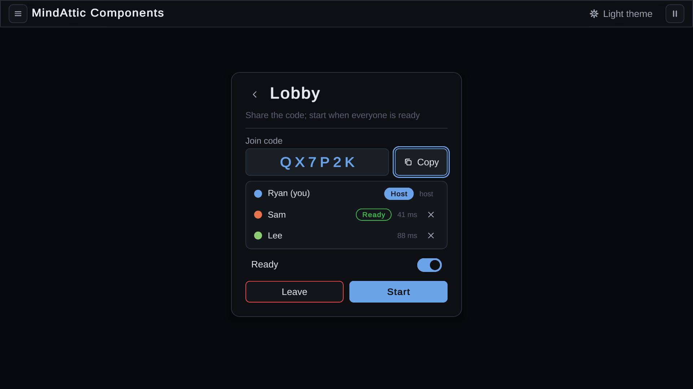
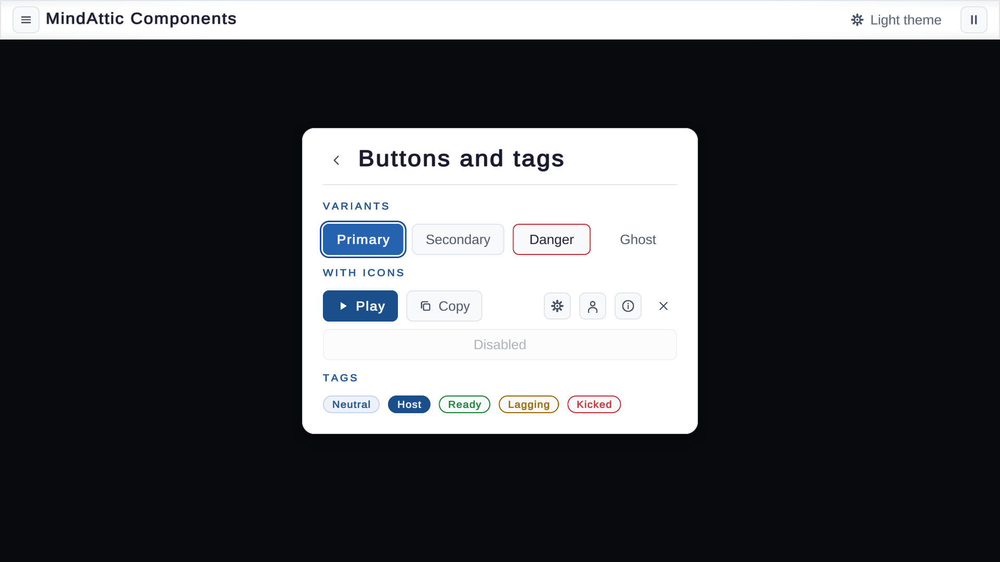

# MindAttic Components for Unity

`com.mindattic.components.unity` is the MindAttic design system for Unity 6: themed uGUI + TextMesh Pro menus and controls that use the same palette and token names as `web/themes` and the same looks as `web/components`, so a MindAttic game and a MindAttic page read as one family. Every Unity game's menus, dialogs and HUD are built from it, so a button, a menu or a theme changes in one place.



## What's in the package

| Assembly | Namespace | What |
|---|---|---|
| `MindAttic.Components.Unity.Core` | `MindAttic.Components.Unity.Core` | Engine-free (`noEngineReferences`): the token model (`ThemeColor`, `ThemePalette`, `ThemeTokenNames`, `ThemeMetrics`), `CssTokenParser` (reads any `web/themes` stylesheet), `ControlStyles` (every control's colours per state), `Contrast` + `ThemeValidator` (WCAG AA), `NavigationGraph`, `MenuStackModel<T>`, `FocusTrapModel<,>`, `MenuDefinition` + `MenuValidator`, `ToastQueue`, `BannerQueue`, `MinimapFit` + `MapRect`, `StatusKind`, `Motion` |
| `MindAttic.Components.Unity` | `MindAttic.Components.Unity` | The components, the theme provider, the canvas/EventSystem helpers and the back router |
| `MindAttic.Components.Unity.Editor` | `MindAttic.Components.Unity.Editor` | GameObject > MindAttic UI menu, the ThemeTokens inspector, the prefab builder, menu validation, the TMP Essentials importer |

Unity 6000.0 or later. The only dependency is `com.unity.ugui` 2.0.0 (uGUI with TextMesh Pro built in). The Input System is optional: with it installed and enabled the package uses `InputSystemUIInputModule`, otherwise the old `StandaloneInputModule`; both drive everything.

## Install

Add it to the game's `Packages/manifest.json`. The MindAttic games keep this repo next to theirs and reference it by path:

```json
"com.mindattic.components.unity": "file:../../MindAttic.Components/unity/com.mindattic.components.unity"
```

TextMesh Pro needs its Essential Resources in the project. The package's editor imports them the first time it loads (no pop-up, also in batch mode); MindAttic > Components > Import TMP Essentials does it by hand, and `EditorPrefs.SetBool("MindAttic.Components.AutoImportTmp", false)` turns the automatic import off.

## Quick start

```csharp
using MindAttic.Components.Unity;
using MindAttic.Components.Unity.Core;

var stack = MenuStack.Create();                    // its own 1920x1080-reference canvas + EventSystem
var main = stack.CreateScreen("My Game");
main.AddButton("Multiplayer", () => stack.Push("Multiplayer", s =>
{
    s.AddButton("Host", OnHost, ButtonVariant.Primary, MaIcon.Play);
    var code = s.AddTextbox("Join code", "ABC123").AsCode(6);
    s.AddButton("Join", () => OnJoin(code.Text));
}), ButtonVariant.Primary);
main.AddToggle("Reduce motion", false, v => MaTheme.ReduceMotion = v);
main.AddButton("Quit", Application.Quit, ButtonVariant.Danger, MaIcon.Exit);
stack.Push(main);
```

Or one screen on an existing canvas: `var menu = MenuScreen.Create(canvas, "Multiplayer"); menu.AddButton("Host", OnHost);`. Everything is also available as a prefab (`Runtime/Prefabs`) and from GameObject > MindAttic UI.

## Theming

`ThemeTokens` is a ScriptableObject with one colour per token, the size metrics and an optional TMP font. `MaTheme` is the provider: `MaTheme.Current` is what every component draws with, and changing it (or editing the current asset) restyles everything live.

| Web token | `ThemeTokens` field | Used for |
|---|---|---|
| `--bg` | `bg` | Menu cards, dialogs, toolbars |
| `--bg2` | `bg2` | Buttons and fields at rest, lists |
| `--bg3` | `bg3` | Hover, tracks, code wells |
| `--border` | `border` | Hairlines |
| `--accent`, `--accent2` | `accent`, `accent2` | Primary fills, focus rings, slider fills; a hovered primary |
| `--text`, `--text2`, `--text3` | `text`, `text2`, `text3` | Body, labels and idle buttons, placeholders and captions |
| `--tag-bg`, `--tag-text`, `--tag-border`, `--tag-hover-bg`, `--tag-hover-text` | `tagBg`, `tagText`, `tagBorder`, `tagHoverBg`, `tagHoverText` | `MaTag` |
| `--rule` | `rule` | Section rules |
| `--danger`, `--danger2` *(Unity)* | `danger`, `danger2` | Danger buttons (the web's `.ma-btn` red) |
| `--success`, `--warning` *(Unity)* | `success`, `warning` | Toasts, tags |
| `--on-accent` *(Unity)* | `onAccent` | Text on an accent or danger fill |
| `--overlay`, `--shadow` *(Unity)* | `overlay`, `shadow` | Modal backdrop, drop shadows |

`MaTheme.Dark` (the default) and `MaTheme.Light` carry the exact values of `web/themes/Dark/dark.css` and `web/themes/Light/light.css`; `dotnet test unity/tests/Core.Tests` parses those files and fails if they drift. Any other web theme loads with `ThemeTokens.FromCss(css, "ocean")` or the inspector's Load web theme CSS button; tokens a stylesheet leaves out come from the built-in theme of matching darkness.

```csharp
MaTheme.UseLight();                // or UseDark(), Toggle(), Apply(myTokens)
MaTheme.ReduceMotion = true;       // every transition instant; spinners pulse instead of turning
var ocean = ThemeTokens.FromCss(File.ReadAllText(path), "ocean");
MaTheme.Apply(ocean);
```

A `ThemeProvider` component sets the theme and reduce motion from the inspector. `Runtime/Themes/Dark.asset` and `Light.asset` are ready-made assets to duplicate. The inspector checks the palette against WCAG 2.2 AA (`ThemeValidator`: text on every surface, on-accent text, status dots, and every button variant's label on its fill at rest, selected, selected-and-disabled at 4.5:1 and disabled at 3:1) and copies it as CSS for a matching web theme.

`ThemeMetrics` is the size scale, in canvas units at 1920x1080 (the web's pixel sizes doubled): spacing 4/8/16/24/32/48, radii 12/16/24, control height 60, menu width 640, type 20/24/26/32/46, transitions 0.15 s and 0.28 s with the web's `cubic-bezier(0.4, 0, 0.2, 1)`.

## Components

Every component is a `MaElement` (a MonoBehaviour) with a static `Create(parent, ...)`; `parent` is any component (a Canvas, a screen's `Items`, a row). Controls are stock uGUI selectables underneath (`Button`, `Toggle`, `Slider`, `TMP_InputField`, `TMP_Dropdown`), so inspector events and existing code still work; the package switches their own colour transitions off and draws states itself.

| Component | Create | Notes |
|---|---|---|
| `MaButton` | `Create(parent, label, onClick, variant = Secondary, icon = None)` | `Label`, `Variant` (`Primary`, `Secondary`, `Danger`, `Ghost`), `Icon`/`IconSprite`, `Interactable`, `Selected` (the chosen one, e.g. a vote's answer: drawn filled and kept that way, label at AA, when also disabled), `OnClick`, `Click()`, fluent `WithVariant`, `WithIcon`, `WithSelected`, `OnClicked`, `WithWidth`, `Stretch`, `WithTooltip`. A disabled button fades, but its label keeps 3:1 on the faded fill |
| `MaIconButton` | `Create(parent, icon, onClick, tooltip, variant)` | Square; `Tooltip`, `WithSize` |
| `MaToggle` | `Create(parent, label, value, onChanged)` | A switch; the whole row is the control; Left/Right set it; `Value`, `ValueChanged`, `SetValueWithoutNotify` |
| `MaTextbox` | `Create(parent, label, placeholder, onSubmit, onChanged)` | `Text`, `Placeholder`, `Label`, `ReadOnly`, `IsEditing`, `Focus()`, `WithContentType`, `WithCharacterLimit`, `AsCode(length)` (letters/digits, upper case) |
| `MaSelect` | `Create(parent, options, index, onChanged)` | Dropdown; Left/Right step it while closed; `Value`, `SelectedText`, `SetOptions`, `Open`, `Close`, `IsExpanded`, `WrapWithArrows` |
| `MaRange` | `Create(parent, min, max, value, onChanged, wholeNumbers)` | Slider; `Value`, `Min`, `Max`, `Format`, `ShowValueIn(label)` |
| `MaProgressBar` | `Create(parent, value, indeterminate, height)` | `Value` 0..1 (eases), `Indeterminate` |
| `MaSpinner` | `Create(parent, size)` | Busy ring; `Period` |
| `MaTooltip` | `Attach(target, text)` / `element.WithTooltip(text)` | Hover (after 0.45 s) and keyboard/gamepad focus; `Show`, `Hide` |
| `MaToast` | `MaToast.Show(message, kind, title, seconds)` | `ToastKind` Info/Success/Warning/Error; three at once, the rest queue; `DismissAll`, `OnScreen` |
| `MaModal` | `Create(title, parent)`, `Alert`, `Confirm`, `ConfirmAsync`, `Busy` | Focus trap; `AddMessage`, `Add(element)`, `AddButton(label, onClick, variant, closes)`, `Open`, `Close`, `Cancel`, `OnCancel`, `Closed`, `Dismissable`, `DismissOnBackdropClick`, `SetMessage`, `Top`, `OpenCount`, `CloseAll` |
| `MaToolbar` | `Create(parent, dock = Top)` | `AddButton`, `AddIconButton`, `AddText`, `AddFlexibleSpace`, `Add(element)`; wires its own Left/Right navigation when it stands alone |
| `MaRow` | `Create(parent, equalWidths)` | Side-by-side controls, one navigation row |
| `MaFormRow` | `Create(parent, label, control, showValue)` | Label column + control (+ live readout for a range) |
| `MaCodeDisplay` | `Create(parent, label, code)` | Large spaced read-only code + Copy (clipboard, "Copied" flip, toast); `Code`, `Copied`, `ToastOnCopy` |
| `MaList` / `MaListRow` | `MaList.Create(parent, maxVisibleRows, emptyText)`, `list.AddRow(text, swatch, detail, onClick)` | Roster rows: colour swatch, text, `AddTag`, detail on the right, `AddAction(icon, onClick, tooltip)`; scrolls the focused row into view; `Remove`, `Clear` |
| `MaTag` | `Create(parent, text, tone)` | Pill; `TagTone` Neutral/Accent/Success/Warning/Danger |
| `MaText` | `Create(parent, text, style, alignment)` | `TextStyle` Title/Heading/Body/Label/Muted/Caption/Section/Control/Code |
| `MaPanel` | `Create(parent, style)` | `PanelStyle` Surface (card with shadow), Raised, Inset, Bar |
| `MaStatusPill` | `Create(parent, text, kind = Neutral, pulse = null)` | HUD status: a dot in the `StatusKind` colour (Ok success, Warn warning, Error danger, Neutral muted) and the label in body text; `Set(text, kind)` (cheap every frame), `Text`, `Kind`, `Pulse` (the dot breathes; default on for Warn, still with reduce motion) |
| `MaBanner` | `Create(parent, width = 1100)` | Timed title + muted subtitle card, centred; `Show(title, subtitle, seconds = 3, replace = false)` fades in, holds, fades out (instant with reduce motion); later ones queue unless `replace`; `Dismiss`, `Clear`, `IsShowing`, `Current`, `PendingCount`; never blocks the pointer |
| `MaMinimap` | `Create(parent, size = 320, resolution = 160, padding = 8)` | Inset panel drawing caller-supplied world rects and points: `Clear()`, `AddRect(MapRect, colour, fit = true)`, `AddPoint(x, y, colour, radiusPx, fit = false)`, `SetViewport(MapRect?)`, `Apply()`; `AutoFit` (default) fits the bounds of what was added with `fit` plus `padding` texels, `FitTo(bounds)` pins them; `Panned` gives the world point under a click or drag; `Fit` (the `MinimapFit`), `Texture`, `Backdrop`, `ViewportColor` |
The icons (`MaIcon`: Close, Check, Copy, Chevron*, Back, Plus, Minus, Menu, Info, Warning, Play, Pause, User, Settings, Dot, Exit) and every rounded shape are drawn at runtime from signed distance fields (`MaIcons`, `MaSprites`); the package ships no textures.

## Menus

`MenuScreen` is one page: a centred card with a title (and a back chevron when there is somewhere to go back to), a muted subtitle and a vertical list. `Add*` methods build the list: `AddButton`, `AddTextbox`, `AddToggle`, `AddSelect`, `AddRange`, `AddCode`, `AddList`, `AddProgress`, `AddSpinner`, `AddText`, `AddSection`, `AddRow`, `AddFormRow`, `AddSpace`, `Add(element)`, `Clear`. `Width`, `Panel` and `Items` let a game reposition or extend it; `BackHandler` intercepts back (return true to swallow it, e.g. to confirm leaving a lobby); `Shown`/`Hidden` fire on every change; `Validate()` checks it against the menu rules.

`MenuStack` holds the screens: `Create(parent, backdrop, sortingOrder)`, `CreateScreen(title, subtitle)`, `Push(screen)`, `Push(title, build)` (destroyed when popped), `Pop`, `Replace`, `PopToRoot`, `SetRoot`, `Back()`/`HandleBack()`, `Current`, `Root`, `Count`, `CanGoBack`, `Open`/`Close`/`Toggle`, `IsOpen`, `ScreenChanged`, `Opened`, `Closed`, `EscapeEnabled`, `Backdrop`.

- A pushed screen selects its first control; popping back re-selects the control the player left from.
- `ConfigureAsPauseMenu(root)` makes an in-game Esc menu: dimmed backdrop, starts closed, Esc/B or gamepad Start opens it on its root, back at the root closes it, and it reopens on its root. Pause the game on `Opened`/`Closed`.
- `MaBackRouter` routes Esc/B: a text field being edited or an open dropdown keeps it, else the top modal cancels, else the most recently enabled open stack goes back, else a closed pause menu opens. `MaBackRouter.HandleBack()` routes one from code; `MaBackRouter.Enabled = false` hands Esc back to the game.

## Keyboard, gamepad and pointer

- Navigation is explicit (`Navigation.Mode.Explicit`), wired by `MaNavigation` from the engine-free `NavigationGraph`: Up/Down move through a screen's rows and wrap, Left/Right move inside a row (a button row, a roster row and its kick button), disabled and hidden controls are skipped, and a modal's navigation never leaves the modal.
- The first item is selected when a screen shows; a click on empty space clears uGUI's selection, so the screen puts it back on the next frame.
- A text field is reached like any control; Enter/A starts editing (arrows still move past it), Enter submits, Esc cancels the edit only.
- Focus rings show for keyboard/gamepad use and hide after a pointer press (the web's `:focus-visible`); hovering a control selects it (`MaInput.SelectOnHover`), so the keys continue from where the mouse was.
- `MaCanvas.Create` makes a screen-space overlay canvas scaled from 1920x1080 (match 0.5) with a raycaster and an EventSystem; `MaCanvas.Configure(canvas)` sets up an existing one. Modals, toasts and tooltips live on `MaCanvas.Overlay` (sorting order 29000, kept across scene loads).
- All motion uses unscaled time, so menus animate while the game is paused (`Time.timeScale = 0`).

## Dialogs and feedback

```csharp
MaModal.Alert("Disconnected", reason);
MaModal.Confirm("Leave the lobby?", "The others keep playing.", ok => { if (ok) Leave(); }, "Leave", "Stay", ButtonVariant.Danger);
if (await MaModal.ConfirmAsync("Host a game?", "Others join with your code.")) Host();
var busy = MaModal.Busy("Connecting", "Contacting 10.0.0.2:7777...", onCancel: CancelConnect);
busy.SetMessage("Retrying..."); busy.Close();
MaToast.Show("Join code copied", ToastKind.Success);
```

A Danger confirm starts with focus on the safe button. A busy dialog without `onCancel` can only be closed from code; Esc is swallowed.

## Recipes for the MindAttic games

- **Multiplayer front end (Unity.Multiplayer UM-T48)**: a `MenuStack` with Host / Join by IP (`AddTextbox`) / Join by code (`AddTextbox(...).AsCode(6)`) / Quit; the lobby is a screen with `AddCode("Join code", code)`, `AddList()` rows (`AddRow(name, playerColour, ping)`, `AddTag("Host", TagTone.Accent)`, `AddAction(MaIcon.Close, Kick, "Kick")`), per-player `AddToggle`s and an `AddRow()` of Leave/Start, with `BackHandler` confirming the leave; connecting is `MaModal.Busy(..., onCancel)`; a disconnect reason is `MaModal.Alert`; the in-game menu is a second stack with `ConfigureAsPauseMenu(root)`.
- **HUD and pause (Unity.Cursory UC-T11, UC-T23)**: `MaToolbar.Create(canvas)` along the top (`AddIconButton`, `AddText`, `AddFlexibleSpace`) with a `MaStatusPill` for the connection (`Set("Live", StatusKind.Ok)`, `Set("Connecting...", StatusKind.Warn)`), a `MaBanner` for the level's title when it changes, a `MaMinimap` in a corner fed the level's walls, goals and bodies (`fit: true`), the players as points and the camera as the viewport, panning the camera on `Panned`, `MaToast` for events, and a pause stack as above.

## Prefabs and editor tools

- `Runtime/Prefabs` holds a prefab of every component (Button, Primary Button, Danger Button, Icon Button, Toggle, Textbox, Select, Range, Progress Bar, Spinner, Tag, Code Display, List, Toolbar, Panel, Menu Screen, Menu Stack). They are built by the same code as `Create` (MindAttic > Components > Rebuild Package Prefabs) and get their generated sprites when enabled.
- GameObject > MindAttic UI adds any component under the selection, or on a new MindAttic canvas.
- MindAttic > Components > Validate Menus In Open Scenes runs every `MenuScreen` through `MenuValidator`: a title, at least one focusable item (so a gamepad player is never stranded), labelled controls, no duplicate button labels.

## Sample

Package Manager > MindAttic Components > Samples > Gallery imports `Gallery.unity`: every component in both themes (a toolbar button switches), a multiplayer front end with a lobby, the inputs, progress, dialogs and toasts, the HUD widgets (status pills, a level banner, a minimap that pans on click), and a pause menu on Esc.



## Testing

```powershell
dotnet test unity/tests/Core.Tests                         # engine-free Core (net10 NUnit; Core.Build checks netstandard2.1 / C# 9)
powershell -File unity/tests/run-editmode.ps1              # editor: CSS-to-ThemeTokens, theme assets, prefabs, GameObject menu, validation
powershell -File unity/tests/run-playmode.ps1              # runtime: construction, theming, menu stack, navigation, modal focus, toasts, HUD widgets
```

The Unity suites run in batch mode on Unity 6000.4.3f1 in `unity/tests/UnityHost`, a bare project whose manifest references the package by `file:` path, lists it in `testables` and adds the Input System (active input handling: both) and the engine modules most games have (animation, audio, physics, physics 2D), so a name that clashes with a `UnityEngine` type in a real game (`UnityEngine.Motion` from the animation module, M.COMP-T44) fails the suites here first. Its `Library/`, logs and the imported TMP Essentials are git-ignored; the scripts import TMP Essentials on a clean checkout before the first run.

## Layout

```text
unity/
  com.mindattic.components.unity/     the UPM package
    Runtime/Core/                     engine-free Core (noEngineReferences)
    Runtime/{Theming,Rendering,Infrastructure,Controls,Menus}/
    Runtime/Prefabs/, Runtime/Themes/ generated prefabs and Dark/Light ThemeTokens assets
    Editor/                           menus, inspector, prefab builder, validation, TMP Essentials
    Tests/Runtime/, Tests/Editor/     PlayMode and EditMode suites
    Samples~/Gallery/                 the Gallery scene
  tests/Core.Tests/, tests/Core.Build/
  tests/UnityHost/                    the batch-mode test host
  tests/run-editmode.ps1, run-playmode.ps1
```
